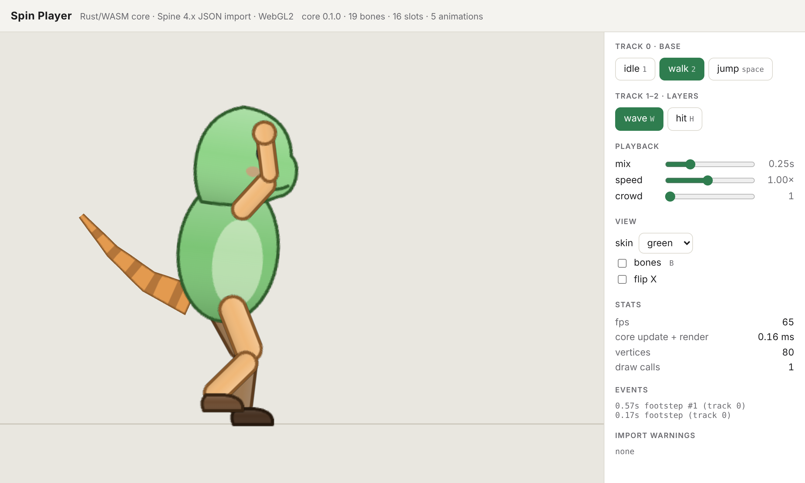

# RABBIT

面向独立团队的 2D 骨骼动画平台。产品形态见 [docs/PRODUCT.md](docs/PRODUCT.md)，架构见 [docs/ARCHITECTURE.md](docs/ARCHITECTURE.md)，路线图见 [docs/ROADMAP.md](docs/ROADMAP.md)。

**在线试用**：[RABBIT Studio](https://rabbit-studio.willemzhang1.workers.dev/studio/) · [Player](https://rabbit-studio.willemzhang1.workers.dev/demo/)




## 结构

| 路径 | 内容 |
|---|---|
| `crates/sinew-core` | Rust 内核：数据模型、骨骼求值、IK/Transform 约束、通用属性通道动画、多轨道混合、渲染批次、Spine 4.x JSON 导入、atlas 解析 |
| `crates/sinew-ffi` | C ABI；同一套导出用于 WASM 与原生引擎 |
| `web/runtime` | TS 运行时：WASM 封装（零拷贝读取缓冲）、WebGL2 渲染器（PMA、双色 tint、混合模式） |
| `web/studio` | RABBIT Studio：单图 → 自动抠图/网格/骨架/权重 → 动作库 → 时间轴编辑 → 导出 Spine 4.2 |
| `web/demo` | 演示播放器（含 Spine 官方示例浏览，示例需本地下载） |
| `tools/gen-demo.mjs` | 生成演示角色（Spine 4.2 JSON 格式，自有内容） |

## 运行

```bash
rustup target add wasm32-unknown-unknown
cargo test
cd web && npm install && npm run dev   # http://127.0.0.1:5173
```

快捷键：`1` idle · `2` walk · `空格` jump · `W` wave（track 1 叠加）· `H` hit（track 2）· `B` 骨骼显示。

## 部署

```bash
./tools/build-deploy.sh            # 构建并把 dist 推到 deploy 分支，输出 commit
```

`tools/worker.js` 已部署为 Cloudflare Worker `rabbit-studio`，从公开仓库的 `deploy` 分支取文件并在边缘缓存（约 5 分钟生效），推送 deploy 分支即完成发布。
